<p align="center">
  
</p>

<p align="center">
  <strong>Zyroflo — the generic SDLC harness.</strong><br>
  AI-driven software delivery under <strong>strict human governance</strong>. Drop it into any repo;
  run your whole lifecycle end-to-end — under any LLM, inside any AI coding tool.
</p>

<p align="center">
  <strong>100% free &amp; open source (MIT)</strong> — no third-party packages, no network, no API keys.<br>
  Product page → <a href="https://cbeyond.cloud/zyroflo" target="_blank" rel="noopener"><strong>cbeyond.cloud/zyroflo</strong></a>
  &nbsp;·&nbsp;
  <a href="https://youtu.be/v_1nk1uJCRE" target="_blank" rel="noopener"><strong>Watch the explainer ▶</strong></a>
</p>

[](https://github.com/sumitdevgupto/sdlc-harness/actions/workflows/ci.yml)
[](LICENSE)
[](https://www.python.org/downloads/)
[](#no-packages-no-network-no-api-keys)
[](https://github.com/sumitdevgupto/sdlc-harness/stargazers)

**Zyroflo** is a portable, **provider-agnostic** and **tool-agnostic** software-development lifecycle you drop into **any** repo. One command scaffolds it; one command per task runs the whole lifecycle end-to-end — hand it a bug or a one-line feature and it elaborates the requirement, asks the clarifying questions, then designs, implements, tests and prepares the deploy, with a human at every gate.

🎯 **10 phases · 2 human gates** &nbsp;·&nbsp; 🔌 **6 AI coding tools** &nbsp;·&nbsp; 🧩 **8 stacks auto-detected** &nbsp;·&nbsp; 🧾 **hash-chained approval ledger + CI check** &nbsp;·&nbsp; 📦 **0 dependencies** &nbsp;·&nbsp; 🏷️ **MIT**

> AI can now take a whole feature from ticket to deploy — so the question that decides whether you can actually *use* it is **governance**: when a change ships, who approved it, which model wrote it, and can you prove it later? Zyroflo makes those decisions first-class — gates that stop, a ledger that proves, a pipeline you shaped — so AI-driven delivery stays adoptable where an audit trail is non-negotiable.

**Why teams use it:**
- 🪄 **Drop-in** — one command scaffolds the whole lifecycle into any repo, and fans the same skill out to every AI coding tool it detects, each in its native format. Nothing about how your team already works has to change.
- 🚦 **Human-governed** — the AI proposes; a person disposes. The approval gates are **hard stops**, not checkpoints the pipeline glides past — it does not move until you say so.
- 🧾 **Provable** — every gate decision is a hash-chained line in an append-only ledger, and the installed CI check refuses a merge whose gate is missing, rejected, or approved over bytes that have since moved.
- 🔌 **Any tool, any model, any stack** — no provider, model, or tool name in the lifecycle; commands are profile data. Claude Code, Cursor, Windsurf, Copilot, Gemini, Aider — and pytest, Maven, cargo, `dotnet`, rspec, ctest, or your own.
- 🧠 **It never calls a model itself** — your keys, your providers, your spend. The harness governs the work; the runner does the spending ([`RUNNER_CONTRACT.md`](RUNNER_CONTRACT.md)).
- 📦 **Zero-dependency** — no third-party packages, no network, no API keys. That promise is a **test**, not a claim.
- ♻️ **Resumable** — durable state is plain markdown in `.sdlc/plans/`, so a run survives across sessions and even across tools.

---

## Quick Start

```bash
# 1. Install into a repo (run at its root, or use --target). Run from a clone of this
#    harness, it also builds that repo's graph into .sdlc/graph; run as a standalone
#    file it scaffolds and says plainly that no graph was built. --no-graph skips it.
python /path/to/sdlc-init.py
#    The FIRST run stops and writes sdlc-project.toml: fill in name, description,
#    owner and criticality (low | medium | high) once, then run it again. It is the
#    one file INIT asks you for - committed with the code, stamped into every run.

# ...or across a workspace of many repos (see "Multi-component workspaces")
python sdlc-init.py --workspace sdlc-workspace.toml

# 2. In any AI coding tool opened on that repo:
/sdlc fix the null-pointer in the CSV importer
/sdlc add pagination to the /orders endpoint
/sdlc resume                                     # continue an interrupted run
```

### No packages, no network, no API keys

Free and OSS (MIT). One scoped exception: the chained graph build runs from the harness clone's locked `uv` environment, and its first run in a fresh clone syncs that environment over the network — `--no-graph` (or the standalone file) keeps the install itself dependency- and network-free.

That promise is a test, not a claim (`tools/tests/test_zero_dependency_parity.py`): with nothing installed and the network blocked, install and build still complete. Formats that need an absent library or grammar (YAML, Java, TypeScript, …) are then **reported as unread, per component, in the build's unresolved output** — the graph is degraded and says exactly where, never silently short.

## What it does

Takes a single input — a bug or feature — through **10 phases** with **two human approval gates**:

```mermaid
flowchart LR
    P0["0 · Intake<br/>& baseline"] --> P1["1 · Requirements<br/>clarify + EARS"] --> P2["2 · Planning<br/>plan + tracker"]
    P2 --> GA{{"GATE A<br/>you approve"}}
    GA --> P3["3 · Implement<br/>TDD, commit/row"] --> P4["4 · Review loop<br/>until no crit/high"] --> P5["5 · Triage"]
    P5 --> GB{{"GATE B<br/>you approve"}}
    GB --> P6["6 · Fix cycle"] --> P7["7 · Test &<br/>coverage gate"] --> P8["8 · Close-out"] --> P9["9 · Deploy<br/>(optional)"]

    classDef gate fill:#241127,stroke:#ff3d9a,stroke-width:2px,color:#ff8fc7;
    classDef phase fill:#141a2e,stroke:#2a3350,color:#e8ecf5;
    class GA,GB gate;
    class P0,P1,P2,P3,P4,P5,P6,P7,P8,P9 phase;
```



| Phase | What happens |
|---|---|
| **0 · Intake & Baseline** | clean-tree + baseline tests + scope triage + explore |
| **1 · Requirements** | clarify sweep, 2–4 options (incl. a free/OSS one), EARS criteria |
| **2 · Planning** | plan doc + tracker in `.sdlc/plans/`, consistency check |
| **GATE A** | **← you approve — STOPS** |
| **3 · Implementation** | branch, parallel worktrees where supported, TDD, commit per row |
| **4 · Review loop** | re-review until no critical/high finding is open (max 5 iterations); the /10 rubric score is reported, never the gate |
| **5 · Triage** | findings become top-priority tracker rows |
| **GATE B** | **← you approve — STOPS** |
| **6 · Fix cycle** | loop 1–5 until no pending bug rows |
| **7 · Test & coverage gate** | full suite ≥ baseline, ≥90% on changed files |
| **8 · Close-out** | verify every criterion, docs, final commit, retrospective |
| **9 · Deploy** *(optional)* | only on explicit approval; never auto-runs a paid action |

## Why it's generic

Everything workspace-specific lives in **`profile.yml`** — auto-detected (test/coverage/lint/build/deploy commands, threshold, tools). The skill in `.claude/skills/sdlc/SKILL.md` reads the profile and **hardcodes no command, no provider, no model**. The installer fans the same skill out to every AI coding tool it detects (Claude Code, Cursor, Windsurf, Copilot, Gemini, Aider), each in its native format. Durable state is plain markdown in `.sdlc/plans/`, so a run resumes across sessions and tools.

Genericity runs on three axes, each of which is meant to be a test rather than a claim:

- **Provider-agnostic** — no provider, model, or tool name in the lifecycle. What a non-Claude runner must do is written down in [`RUNNER_CONTRACT.md`](RUNNER_CONTRACT.md) and checked by running it: `tools/provider_smoke.py --runner "<command>"` is the conformance test.
- **Stack-agnostic** — commands are profile data; the harness never assumes pytest or Maven.
- **Scale-agnostic** — see below.

## Two tiers, one lifecycle

**One repo with zero dependencies and a multi-repo workspace with a graph substrate are the same lifecycle.** They differ only in which capabilities are present and which phases the profile activates — not in gates, not in artifacts, not in the review loop. Neither is a degraded version of the other.

| | **Tier 0 — drop-in** | **Tier 1/2 — estate** |
|---|---|---|
| Scope | one repo | N repos (`components[]`) |
| Dependencies | **none** — no packages, no network, no API keys | uv, Docker, Neo4j |
| Phases active | 8 | 12 |
| Change review | whole branch diff at G4 | every agent diff, individually |
| Impact analysis | agent explores the repo | graph blast radius with `file:line` provenance |
| Install | `python sdlc-init.py` | `python sdlc-init.py --workspace sdlc-workspace.toml` |

The full phase list, the capability-degradation table, and the gate regimes are specified in **[`sdlc/LIFECYCLE.md`](sdlc/LIFECYCLE.md)**. Tier 0 is not a stripped-down mode you graduate out of — it is the whole product for a solo developer, and its "no packages, no network" property is a gate the estate tier is not allowed to break.

> **Status.** Tier 0 is complete and is what `/sdlc` runs today. The estate/graph tier is under
> active construction; its current, authoritative state — which extractors, stores and phases are
> live — is tracked in [`SDLC-harness-backlog.md`](SDLC-harness-backlog.md) and specified in
> [`sdlc/LIFECYCLE.md`](sdlc/LIFECYCLE.md), rather than pinned to a date here. `SKILL.md` implements
> the 10-phase numbering it shipped with; `LIFECYCLE.md` documents the mapping onto the 12-phase
> superset. Tier 0's "no packages, no network" property is a gate the estate tier is not allowed to
> break.

## Multi-component workspaces

The harness never hardcodes a path, a repository name, or how many there are. Everything about *your* workspace enters through one file that you write and that stays yours:

```bash
cp sdlc_templates/workspace.example.toml sdlc-workspace.toml
```

Set `root` — the directory containing your repos — and run:

```bash
python sdlc-init.py --workspace sdlc-workspace.toml
```

**`root` is the only required field.** Everything else is detected and merely overridable, because asking you to enumerate components, roles and identity collisions *before the first scan* asks questions you cannot yet answer. Discovery finds every child directory with a `.git`, runs the same stack and VCS detection the single-repo path uses, and writes the result into `components[]`.

Come back to the file only for what detection cannot reach: which directories to include or exclude, a component's `role` (a fork and its upstream are byte-identical to a scanner), and `[[canonical]]` ownership — filled in only once the build reports a collision.

Your filled-in copy is gitignored here, `--workspace` takes a path so it can live anywhere, and the leak guard's ban list is generated *from* it — so the one file that describes your workspace is the one file that tells the guard what must never leak out of it.

## What gets installed into a repo

```
.claude/skills/sdlc/SKILL.md      # + one entry point per detected tool (.cursor/rules/…, GEMINI.md, …)
.sdlc/profile.yml                 # auto-detected; the one file you edit
.sdlc/review-rubric.md
.sdlc/plan-template.md
.sdlc/plans/                      # per-run plan + tracker docs (durable, resumable state)
.sdlc/runs/<run-id>/              # one folder per run: state.json + the hash-chained approvals.jsonl
.sdlc/ledger_check.py             # the approval-ledger gate, as one dependency-free file
.github/workflows/sdlc-ledger.yml # runs it on every PR  (GitHub repos only)
```

## The approval ledger, and why CI checks it

Every gate decision is a line in `.sdlc/runs/<run-id>/approvals.jsonl`, hash-chained with the standard library so an edited line is visible. Hashing alone cannot catch a *wholesale* rewrite — recompute every hash and the file is consistent again — so the installed workflow compares the ledger against the pull request's base commit and requires it to have been **appended to, never rewritten**. It also refuses a `sdlc/<run-id>` branch whose merge gate is missing, rejected, or approved over bytes that have since moved.

```bash
python .sdlc/ledger_check.py --ledger --target . --base origin/main
```

That file is generated, self-contained, and standard-library only: no harness clone, no packages, no network. Installing the workflow does not *enforce* it — GitHub only requires a check a branch protection rule names, and that grant is the repository owner's to make.

## Installer reference

| Flag | Purpose |
|------|---------|
| `--target DIR` | Install into `DIR` (default: current directory) |
| `--workspace TOML` | Multi-component install: discover the components a filled-in `sdlc-workspace.toml` describes and render them into `components[]`. Supplies *which* components exist; `--target` still says *where* the config is written |
| `--dry-run` | Show planned writes, change nothing |
| `--tools auto\|all\|<list>` | Which tools to wire (default: `auto` = detect; Claude always included) |
| `--force` | Overwrite a hand-edited `.sdlc/profile.yml` |
| `--claude-extras` | Also install the Claude Code power layer (subagents + hooks + permission allowlist) |
| `--no-graph` | Scaffold only — skip the chained graph build |
| `--bundle OUT` | Emit a single self-contained script (templates base64-embedded) |
| `--dump-templates DIR` | Write the templates out for editing |

Exit status: `0` = scaffold written (graph built, skipped, or honestly absent); `3` = scaffold written but the chained graph build failed (the scaffold is usable; re-run just the build with the command the output prints); `1` = nothing was installed (bad input); `2` = bad command line.

Idempotent: re-running updates generated files in place, never duplicates, and never clobbers a hand-edited `profile.yml` (it stages `profile.yml.new` instead). Console output is ASCII and stdout is reconfigured to UTF-8, so it runs on a default Windows cp1252 terminal.

## Supported AI coding tools

The base install is tool-neutral: the installer detects which tools a repo uses and writes the **same** lifecycle into each, in that tool's native entry-point format.

| Tool | Entry point written |
|---|---|
| **Claude Code** | `.claude/skills/sdlc/SKILL.md` (always included) |
| **Cursor** | `.cursor/rules/sdlc.mdc` |
| **Windsurf** | `.windsurf/rules/sdlc.md` |
| **GitHub Copilot** | `.github/copilot-instructions.md` |
| **Gemini** | `GEMINI.md` |
| **Aider** | `CONVENTIONS.md` |

`--tools auto` (the default) wires only the tools it detects; `--tools all` wires every one; `--tools <list>` picks. Pass `--claude-extras` for the Claude Code power layer (below).

## Detected stacks

Python (pytest) · JavaScript/TypeScript (jest/vitest) · Go · Rust · Java (Maven/Gradle) · **.NET/C#** (dotnet test) · **Ruby** (rspec/rake + SimpleCov) · **C/C++** (CMake + ctest) · plus a generic fallback that leaves commands blank for you to fill.

## Repos where raw `git` is unsafe

Some repos must not be driven with plain git — open-core splits with a second git dir, monorepos that route files per destination, signing/policy wrappers. `profile.yml` has a `vcs:` block for this:

```yaml
vcs:
  commit_command: "./checkin-push.sh \"{message}\""   # {message} = commit text
  push_command: ""                                     # {branch} = branch name
  deny_raw_git: true    # harness must NEVER call git commit/push/worktree
  notes: "open-core split: .git is public, .git-commercial is private"
```

The installer detects this automatically: a `.git-*` dir beside `.git` sets `deny_raw_git: true`, and a repo-level check-in script (`checkin-push.sh`, `commit-push.sh`, …) is wired as `commit_command`. When `deny_raw_git` is on, the harness commits through your script, refuses to `git push`, **and skips git worktrees** — a worktree carries only `.git`, so the second repo would be silently lost. `--claude-extras` mirrors this in `settings.json` (raw `git commit`/`push`/`worktree` denied, your script allowed). If the signal fires but no script is found, `/sdlc` stops at Phase 0 and asks rather than guessing.

## Optional: Claude Code power layer (`--claude-extras`)

The base install is tool-neutral. Add `--claude-extras` to also install a Claude Code-only layer (other tools ignore it):

- **Reviewer subagents** — `.claude/agents/sdlc-reviewer.md` + `sdlc-security.md`. Phase 4 delegates to these isolated-context reviewers for sharper, more independent findings.
- **Permission allowlist** — `.claude/settings.json` auto-allowing exactly the profile's test/coverage/lint/build binaries and safe local git (status/diff/commit/branch/worktree), so the automated loop doesn't stall on prompts. Destructive ops (force-push, `reset --hard`, `clean -f`, `rm -rf`) are explicitly denied. Merges with any existing `settings.json` — never clobbers.
- **Automation hooks** — `.claude/hooks/`: a PostToolUse hook auto-runs the linter after edits (non-blocking), and a SessionStart hook surfaces any in-progress run so you can `/sdlc resume`.
- **Default-pointer block** — a managed block in `CLAUDE.md` / `AGENTS.md` so "fix this bug" / "add this feature" routes to `/sdlc` from session start.

`.mcp.json` isn't installed, but the skill is MCP-aware: if a GitHub/JIRA/Linear or Slack MCP is connected, it offers to pull the task from an issue and post the tracker/close-out back.

```bash
python sdlc-init.py --target ../your-repo --claude-extras
```

## Editing the harness

The canonical templates are `sdlc_templates/{SKILL.md, review-rubric.md, plan-template.md, profile.yml}`. Edit those, then re-run the installer in a repo to refresh every tool. Tune scoring per repo by pointing `review.rubric_overlay` in `profile.yml` at a repo-specific additions file.

For a single droppable file (no `sdlc_templates/` sibling needed):

```bash
python sdlc-init.py --bundle sdlc-init.bundled.py
```

## License

MIT — see [LICENSE](LICENSE).
